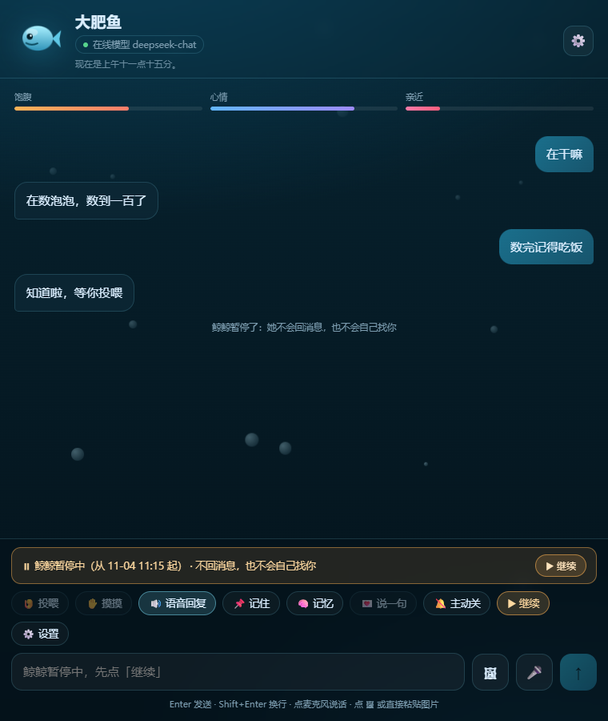
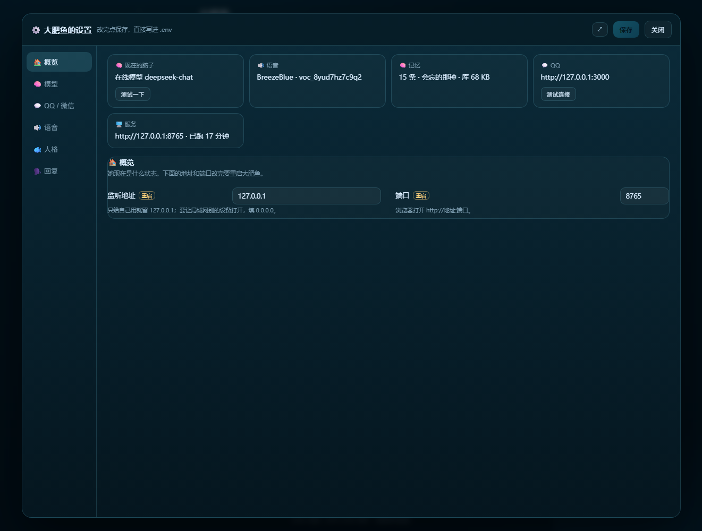
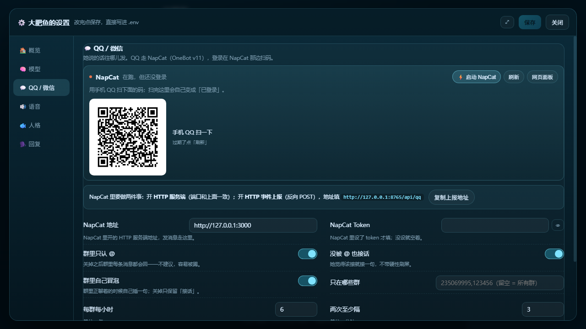
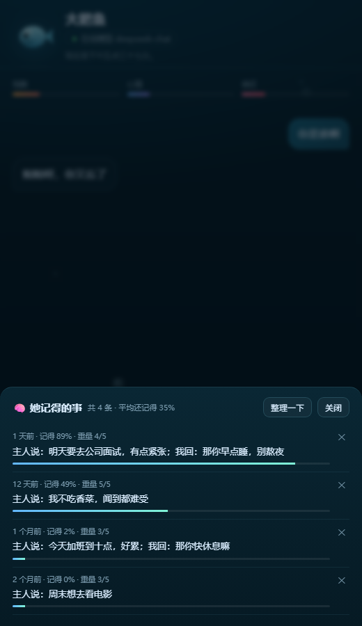

# 大肥鱼 🐟

一条养在你自己电脑里的大胖鱼。会聊天、会记事、会饿、会闹脾气，高兴了还能出声。

- **脑子**：默认走在线 API（DeepSeek，改两行就能换别家）；也支持本地 Qwen / Ollama。
- **记忆**：对话存在本地 SQLite；聊多了自动压成长期笔记，下次还记得。
  另外一份**记忆流**：经历过的事像人一样慢慢变淡，被想起来会变牢，快忘了先记模糊，最后才忘。
- **状态**：饱腹 / 心情 / 亲近三条命，会随时间变饿、变丧，要你投喂和摸摸。
- **她自己会变**：人格里留一小段给她自己，攒够经历才改一条，改了什么、为什么都留着底，能退回。
- **声音**：说话用 edge-tts，听话用 faster-whisper，都在本地跑。
- **她的窗**（可选）：填个城市，她就知道外面天黑没黑、什么月亮、下没下雨。
- **出口**：网页界面、QQ、微信（第三方桥）。

---

## 桌面版：点一下就开（没有黑窗口）

装两个小包：`pip install -r requirements-desktop.txt`，然后双击 **`启动大肥鱼.vbs`**。

右下角托盘里多一条小肥鱼，左键打开窗口、右键出菜单：

| 菜单 | 干什么 |
|---|---|
| 打开大肥鱼 | 打开原生窗口（没有地址栏）；没装 pywebview 时退回 Edge 的无地址栏模式。关掉窗口不会停服务 |
| 重启服务 | 重启后台的 `python -m app`（日志在 `data/app.log`） |
| 开机自启 | 勾上就写进注册表 `HKCU\...\Run`，开机自己进托盘、不弹窗 |
| 打开数据文件夹 / 看日志 | 直通 `data/` 和 `data/app.log` |
| 退出 | 停掉服务、收掉托盘 |

- **只开一份**：重复双击只会把窗口叫出来，不会起第二个服务抢 8765。
- **关窗口 ≠ 关服务**：她还在后台跑（主动消息照发），再点托盘就回来。
- 调试还是用 `大肥鱼.bat`（带黑窗口，能看见日志）。
- 图标是 `tools/make_icon.py` 画的，改颜色重跑一遍就行。

---

## 桌面版 exe（不用装 Python）

`dist\DaFeiYu\DaFeiYu.exe`，双击就能用；窗口是 pywebview 的 EdgeChromium，任务栏图标就是那条鱼。
整个文件夹 84MB，可以直接拷到别的 Windows 电脑上跑（那台机器要有 WebView2，Win11 自带）。

- **数据在哪**：`%APPDATA%\大肥鱼\`（`.env`、`data\fish.db`、人格、表情包）。第一次运行时会把
  exe 旁边的 `.env` 和 `data\fish.db` 搬过去——所以想带走现在的记忆，把这两样放在 exe 旁边再启动一次。
- 之后 exe 和源码版各记各的：源码版用项目里的 `data/`，exe 用 `%APPDATA%`。
  想让源码版也用同一份，设个环境变量 `FISH_HOME=%APPDATA%\大肥鱼` 再启动。
- 关窗口收到托盘；托盘菜单和上面那张表一样。强杀主进程也没事，后台服务会跟着退。
- 日志在 `%APPDATA%\大肥鱼\data\app.log`，超过 2MB 自动转成 `app.log.1`。
  （打包版是窗口程序，启动后台服务时不能让任何控制台程序弹出来——查进程、调系统语音都改成不外露的方式了。）
- **自己重新打包**：`powershell -ExecutionPolicy Bypass -File tools\build_exe.ps1`
  （会自动把 `.env`、`data\fish.db` 放到 exe 旁边，方便下次迁移）。

> 打包配置在 `DaFeiYu.spec`：网页、人格、表情包、图标都塞进 `_internal\`；`faster-whisper` / torch
> 这些大块头没打进去，所以 exe 里的麦克风听写不可用（其余功能都在）。要带听写得另外折腾，体积会翻倍。

---

## 三步跑起来

```powershell
# 1. 装依赖
python -m pip install -r requirements.txt

# 2. .env 里填 API_KEY（对照表见下面「云端脑子」；本机没装本地权重）

# 3. 开缸
.\run.ps1
```

然后浏览器打开 <http://127.0.0.1:8765>。

以后想养它，双击 **`大肥鱼.bat`** 就行，会自动开浏览器。

> 想跑本地模型的话：不用 Ollama 是因为它安装包在 GitHub 上，国内经常下不动；改成从 ModelScope
> 下权重、transformers 直接跑，绕开了 GitHub。你要是能连 GitHub，用 Ollama 会更省显存。

---

## 设置面板（不用再改 .env）

网页右上角 **⚙️** 打开，所有配置都在里面；存完立刻生效，只有「监听地址 / 端口」要重启。

| 页 | 管什么 |
|---|---|
| **概览** | 她现在用的模型、语音、记了多少条、QQ 通不通；「测试一下」会真的问模型一句话 |
| **模型** | 服务商预设（DeepSeek / Kimi / 智谱 / 百炼 / 硅基流动 / OpenRouter）、API 地址与 Key、跳脱程度；换完不用重启 |
| **QQ / 微信** | NapCat 地址与 token、群里「只认 @ / 接话 / 冒泡」、群白名单和限流、微信回发地址；「测试连接」能读出登录的 QQ 昵称（扫码登录还是在 NapCat 里做） |
| **妹妹** | 养不养妹妹、她的 QQ / NapCat 地址 / 端口；「启动 / 停止 / 让鲸鲸找她 / 这一轮重来」，还有她俩聊天的刹车和最近说过的话 |
| **语音** | BreezeBlue 的音色、表演指令、听指令程度、语速、降调、响度；edge 音色、音调、语速；听写模型；语音条 / 表情包的开关和上限。顶上「试听」用的就是当前填的参数，**不保存也能先听** |
| **人格** | `persona.md` 和 `personas/*.md` 直接编辑；保存时备份到 `data/persona-backup/`，下一句话就生效。末尾「我自己改的」那一小段是她自己的，同一页能看到她改了什么、也能退回 |
| **回复** | 记忆窗口、摘要频率、遗忘曲线、上网、城市，以及主动找你的一整套（条数 / 间隔 / 免打扰 / 早晚定时） |

保存只改 `.env` 里对应的那一行，注释和顺序都留着；`data/.env.bak` 是保存前的备份。
也能直接用网址进：`http://127.0.0.1:8765/?settings=1`，`?settings=voice` 直接跳到语音那页。

聊天框上方还有一个 **⏸ 暂停**：点一下她就彻底闭嘴——QQ / 微信不回、不主动找你、群里也不冒泡；
面板、设置、记忆和 NapCat 都还能用，再点 **▶ 继续** 就恢复。暂停状态存在 `data/pause.json`，
重启之后仍然保持暂停，免得正在开会或睡觉时重启，她又突然开口。这不是把 Python 进程挂起——
进程挂起了，网页上的「继续」也就点不动了。





---

## 换脑子

`.env` 里 `FISH_PROVIDER` 四个选择：

| 值 | 行为 |
|---|---|
| `auto`（默认） | 先看 `models/` 有没有模型，再看 Ollama，再看 API_KEY，都没有就离线 |
| `hf` | 只用 `models/` 里的 transformers 模型 |
| `ollama` | 只用本地 Ollama |
| `api` | 只用在线 API |

### 云端脑子（不本地部署）

嫌 1.5B 笨、又不想占显存：`.env` 里写 `FISH_PROVIDER=api`，再填三行，跑的就是在线模型。
只要对方是 OpenAI 兼容接口（`/chat/completions`），不用改一行代码：

| 服务 | `API_BASE` | `API_MODEL` | 备注 |
|---|---|---|---|
| DeepSeek | `https://api.deepseek.com/v1` | `deepseek-chat` | 便宜、中文稳，按量充值 |
| 月之暗面 Kimi | `https://api.moonshot.cn/v1` | `kimi-k2-0905-preview` | 长上下文 |
| 智谱 GLM | `https://open.bigmodel.cn/api/paas/v4` | `glm-4-flash` | 有免费档 |
| 阿里百炼 | `https://dashscope.aliyuncs.com/compatible-mode/v1` | `qwen-plus` | 新号有免费额度 |
| 硅基流动 | `https://api.siliconflow.cn/v1` | `Qwen/Qwen3-8B` | 部分模型免费 |
| OpenRouter | `https://openrouter.ai/api/v1` | `deepseek/deepseek-chat` | 一个 key 通吃各家 |

要点：

- `FISH_PROVIDER=api` 但 `API_KEY` 空着时，会自动退回 `models/` 里的本地模型，不会变哑巴鱼。
- 走云端后 `models/`（3GB）可以删，`requirements.txt` 里的 `transformers` / `accelerate` 也不再必需。
- 断网或额度用完时会回一句「脑子卡住了」，不是崩掉——重启服务即可恢复。

**换更大的本地模型**（本机已删掉本地权重和 torch，想回本地再走这步）：重新拉一个到 `models/`，
把旧的删掉（或者用 `HF_MODEL_DIR` 指定路径），再把 `.env` 改成 `FISH_PROVIDER=hf`。
8G 显存的 4060 上：

| 模型 | 权重 | 显存占用 | 体验 |
|---|---|---|---|
| Qwen2.5-1.5B-Instruct | 3.1GB | ~3.5GB | 快，闲聊够用 |
| Qwen2.5-3B-Instruct | 6.2GB | ~7GB | 明显更聪明，比较吃紧 |
| 7B | — | 装不下 fp16 | 得走 Ollama 的 q4 量化 |

```powershell
python tools/fetch_model.py Qwen/Qwen2.5-3B-Instruct
```

界面右上角显示当前用的是哪个脑子，橙色圆点表示没接上。

---

## 语音

- **听**：点麦克风 → 浏览器录音 → 本地 faster-whisper 转文字。第一次用会下载模型（small 约 480MB），之后秒开。
- **说**：优先 edge-tts（微软在线，音色自然）；国内经常连不上，会自动退回 **Windows 自带语音**——机械一点，但完全离线可用。

音色在 `.env` 里改，三个参数配合出“可爱”：

| 变量 | 作用 | 越可爱怎么调 |
|---|---|---|
| `FISH_VOICE` | edge-tts 音色 | `zh-CN-XiaoyiNeural` 最活泼；`zh-TW-HsiaoYuNeural` 软；`zh-CN-XiaoxiaoNeural` 温柔 |
| `FISH_VOICE_PITCH` | 音调 | 往上加，`+25Hz` 已经像小孩，`+40Hz` 更奶 |
| `FISH_VOICE_RATE` | 语速 | 略快一点更精神，`+6%` 起 |

只对 edge-tts 生效。想要更像「一条鱼」，可以接 GPT-SoVITS 训练自己的音色，替换 `app/voice.py` 里的 `tts()` 就行。

### 换成 BreezeBlue 的「迷糊版」声音

博客里那款「大肥鱼 · 迷糊版」是 BreezeBlue 的音色，Voice ID `voc_8yud7hz7c9q2`。先去 [API keys](https://breezeblue.ai/app/developer/api-keys) 建一个 key，填进 `.env`：

```ini
FISH_TTS=breeze
BREEZE_API_KEY=brz_xxxxxxxx
BREEZE_VOICE_ID=voc_8yud7hz7c9q2
BREEZE_MODEL_ID=breeze-tts-2
```

- 合成顺序：**BreezeBlue → edge-tts → Windows 自带语音**。key 没填、401/403、网络失败都会自动往下退，不会变哑巴鱼。
- 网页的「🔊 语音回复」也会用这个声音；不想每条都花额度，就把网页那个开关关掉，只让 QQ 偶尔发语音条。
- 计费按 BreezeBlue 的规则：1 credit = 10 个计费字符，中文汉字每字 2 credits，$3 / 10,000 credits。Free 套餐每天可领 400 credits，按 50 字一条大约 40 条；QQ 语音条每天本来就只有几条，正常用不会超。详细口径见[官方文档](https://docs.breezeblue.ai/)。
- 想让它更「迷糊」或更软，可以调这几个（都不改音色本身，只改这一次的表演）：

| 变量 | 作用 | 现在用的 |
|---|---|---|
| `BREEZE_INSTRUCTIONS` | 表演指令：语气、气声、快慢、要不要尖 | 声音低一点、软一点，带一点气声…不要尖、不要亮 |
| `BREEZE_GUIDANCE` | 指令强度，1~10，越高越听指令 | `5` |
| `BREEZE_PITCH` | 后期降调，0.85~1.0，0.93 约低一个半音；1.0 = 不降调（第一版） | `1.0` |
| `BREEZE_SPEED` | 语速 0.5~2.0；调快时音调也会跟着上去，想软主要靠上面三个 | `1.0` |
| `BREEZE_NORMALIZE` / `BREEZE_TARGET_DBFS` | 统一把响度拉到目标 RMS，避免某条语音特别小声 | `1` / `-18` |

### 在 QQ 里发语音条 / 表情包

网页里的「🔊 语音回复」是浏览器朗读；QQ 里现在能真的发语音条和表情包：

- **语音**：她想用声音说某一句时，会在那句末尾留一个 `[语音]`。这一句用当前语音引擎（默认 BreezeBlue）念出来，走 NapCat 的 `record` 发出去（mp3 / wav 由 NapCat 自己转，不用另装 ffmpeg）。没念成——TTS 连不上、NapCat 不收——会退回文字，不会把那句话吞掉。
- **表情包**：`stickers/<类别>/` 一个类别一个文件夹，png / jpg / gif / webp 都行。她按心情挑一类发；本地没图就发 QQ 自带小黄脸。
- **QQ 收藏的表情**：她账号里收藏的表情会每 10 分钟同步到 `data/qq-faces/`，发的是原图（gif 也会动）。有标签的按标签挑，比如 `[表情:吃瓜]` 会优先用那张吃西瓜的；没标签的归到「QQ收藏」，随机发。想立刻同步：`python tools/sync_qq_faces.py`。
- **你点名要**：说「发个语音」「来个表情」会绕过「两次之间至少隔多久」，但每天的总量还是照算。
- 这些标记不会发出去，也不会写进记忆；她只按标记办事，模型自己拼不了 CQ 码。

频率和开关在 `.env`：

| 变量 | 作用 | 默认 |
|---|---|---|
| `FISH_VOICE_REPLY` | QQ 语音条开关 | `1` |
| `FISH_STICKER_REPLY` | QQ 表情包开关 | `1` |
| `FISH_VOICE_MAX` / `FISH_VOICE_GAP` | 每个会话每天最多几条 / 两次至少隔几秒 | `6` / `120` |
| `FISH_STICKER_MAX` / `FISH_STICKER_GAP` | 同上，表情 | `12` / `90` |
| `FISH_QQ_FACES` / `FISH_QQ_FACES_MIN` | 同步 QQ 收藏表情 / 每几分钟看一次 | `1` / `10` |

群里的上限会自动减半，免得刷屏。你明确要的那次不受间隔限制，但每天封顶还是照算。

想换成自己的表情图：直接把图丢进 `stickers/开心/`、`stickers/无语/`……（文件夹名就是她挑的类别，可以自己加）。自带的那套只是占位卡，删掉或换掉都行；`python tools/make_stickers.py` 可以重新生成。

QQ 收藏的标签在 `data/qq-faces/index.json`（打包版在 `%APPDATA%\大肥鱼\data\qq-faces\index.json`）：新收藏默认没有标签（只能通过「QQ收藏」随机发），想让她按语义挑，就给那张图的 `tags` 加几个词（比如 `["吃瓜"]`）。改完不用重启，下一次生成提示词就会读到。

> 语音走的是 NapCat 的 `record`，NapCat 4.x 自带 ffmpeg 解码，mp3 能直接发。要是哪条没声，先看 NapCat 日志，再确认 `edge-tts` 能不能连上（国内常 403，会自动退回 Windows 自带语音）。

---

## 看图

网页界面点 **🖼** 选一张，或者直接把图片 **粘贴** 到输入框（截图也行），图会先压到 1024 像素以内再发。
可以配一句话，也可以只发图——她会自己看着说点什么。

- 现在用的 `deepseek-chat` **能识图**（实测能读图里的数字、说得清画面内容），不用另配模型。
- 数据库里只存 `[图] 你那句话` 这个记号，图片本身不落盘，所以历史里不会留缩略图。
- 换别家模型时要确认它支持 OpenAI 的 `image_url` 格式；不支持的话她会回「这张图我看不清」。
- **QQ 也能看**：私聊发图、群里 @ 她发图都行——她按 NapCat 给的图片地址现下（4MB 以内），下完直接看。
  群里没 @ 她的图只会记成一条「[图]」，她不主动凑过来。
- 图下载失败（链接过期、太大、网断了）她会回「这张图我没打开…再发一次？」。

---

## 显卡加速（只在跑本地模型时需要）

走在线 API 的话整节可以跳过——本机已经把 `torch` / `transformers` / `accelerate` 卸了，能省 4GB 多。
以后真要在本地跑，再装回来：

`torch` 默认装的是 CPU 版，跑起来每句话要等十几秒。换成 CUDA 版会快十倍：

```powershell
curl.exe -L -o "$env:TEMP\torch.whl" `
  "https://mirror.sjtu.edu.cn/pytorch-wheels/cu124/torch-2.6.0%2Bcu124-cp313-cp313-win_amd64.whl"
python -m pip install --no-deps --force-reinstall "$env:TEMP\torch.whl"
```

装完重启大肥鱼，终端里出现 `[model] 就绪，运行在 cuda` 就对了（注意看 Python 版本，
上面是 cp313 的轮子，别的版本换对应的文件名）。

---

## 接 QQ

用 [NapCat](https://github.com/NapNeko/NapCatQQ)（或 LLOneBot）把 QQ 挂起来，然后：

1. 启动大肥鱼：`.\run.ps1`
2. NapCat 里开 **HTTP 服务端**，端口 `3000`
3. 开 **HTTP 事件上报**（反向 POST），地址填 `http://127.0.0.1:8765/api/qq`

之后私聊它、或者在群里 @ 它，就会回话。会话按「私聊用户 / 群」分开存，记忆不会串。

### 在面板里一键启动 NapCat

设置 → **QQ / 微信**，最上面那块就是 NapCat：

- **⚡ 启动 NapCat**：跑的就是 NapCat 目录里的 `startNapCat.ps1`，和双击 `启动NapCat.bat` 一模一样——
  会弹 UAC（点「是」），先关掉本机 QQ 再注入。按钮点完就能去干别的，面板会自己轮询。
- 状态一行看明白：`没在跑` → `正在启动` → `QQ 起来了，等 3000 端口` → `在跑，但还没登录` → `已登录 昵称（QQ号）`。
- 没登录时直接把 NapCat 写的 `cache/qrcode.png` 显示出来，用手机 QQ 扫；扫完这块会自动变成「已登录」。
- **网页面板**：打开 NapCat 自己的 WebUI（地址和 token 从 `config/webui.json` 里读）。
- 想换目录：高级选项里的「NapCat 目录」，留空会自动找 `D:\NapCat`、`C:\NapCat` 这些常见位置。



### 群聊里她也会自己搭话

被 @ 一定会回。除此之外她还有两种开口方式（`app/groupchat.py`）：

- **接话**：群友说话时她判断要不要接——附和、吐槽、拆台、接梗、反问都行，不用每条都接。
- **冒泡**：群里一直聊着，她会自己找个时机插一句，不等人点名（`FISH_GROUP_CHIME`）。
  这跟私聊的「补一句」是一个意思，也是群里「自由」的来源。

以前这里写的是「大多数时候你不该接话」「能不说就不说」，模型老老实实照做，结果群里永远
没声——她不是不想说，是被提示词按住了。现在改成「想接就接」，靠下面的硬上限兜底。

**能说几嘴**（硬上限，`FISH_GROUP_*`）：

| 限制 | 默认 |
|---|---|
| 同一个群每小时 | 最多 6 句 |
| 两次之间 | 至少隔 3 分钟 |
| 每天 | 最多 15 句 |
| 没人理 | 连着 3 句没人接，就收声半小时再试 |
| 只看不说的底噪 | 刷屏群每秒最多判断 6 条，不会把模型打爆 |

冒泡只在群里「还热着」的时候发生（15 分钟内有消息），冷场了不会突然自言自语。

**在哪些群**：`FISH_GROUP_ALLOW=235069995,123456` 只在这几个群生效；留空 = 所有群。
`FISH_GROUP_CHAT=0` 整个关掉，`FISH_GROUP_CHIME=0` 只留接话、不冒泡。

⚠️ 群里刷屏会被踢、被举报。上限别关，觉得烦就调小 `FISH_GROUP_MAX_HOUR`。

没有真 QQ 也能先验链路：`python tools/fake_qq.py 你好呀`。

> ⚠️ NapCat 这类是第三方协议端，**违反 QQ 用户协议，有封号风险**，别拿主号玩。

---

## 接微信

个人微信没有官方机器人接口。能用的是第三方桥（wechaty + Gewechat / padlocal 等），**封号率不低，务必用小号**。

大肥鱼提供通用入口 `POST /api/wechat`：

```json
{"text": "在吗", "user": "wxid_xxx", "reply_url": "http://你的桥/reply"}
```

同步返回 `{"reply": "..."}`；如果给了 `reply_url`，还会主动 POST 一份 `{"to": "...", "text": "..."}` 过去。

---

## 妹妹：给鲸鲸找个伴

再养一条鱼——「鱼丸」，鲸鲸的妹妹。她是**另一份大肥鱼**，不是同一个进程里的小号：

| | 鲸鲸 | 鱼丸 |
|---|---|---|
| 人格 | `persona.md` | `sister/persona.md` |
| 记忆 / 状态 | `data/fish.db` | `sister/data/fish.db` |
| 网页面板 | 8765 | 8766 |
| OneBot | `127.0.0.1:3000` | `127.0.0.1:3001` |
| QQ | 大号 | 小号 |

两个人的记忆完全分开，谁也不会把对方的聊天记成「主人说的」。她俩在 QQ 上就是两个好友，
你一句我一句地聊。

### 先准备三样东西

1. **一个 QQ 小号**（手机注册，这个替不了你）；和鲸鲸的号**互相加好友**。
2. **第二份 NapCat**：把 `D:\NapCat` 整个复制成 `D:\NapCat2`，在里面：
   - HTTP 服务端端口改成 **3001**（鲸鲸那份是 3000）；
   - HTTP 事件上报地址改成 `http://127.0.0.1:8766/api/qq`；
   - 扫码登录那个小号。
3. 主面板 → **设置 → 🐠 妹妹**：打开「养个妹妹」，填妹妹的 QQ、她的 NapCat 地址
   （`http://127.0.0.1:3001`）、网页端口（8766），保存。

> ⚠️ 两台 QQ 能不能同时登在一台电脑上，取决于 QQ 版本和你的多开办法。NapCat 自带的
> `startNapCat.ps1` 会**先关掉本机所有 QQ** 再注入，所以第二份得另开一个不杀 QQ 的启动方式；
> 实在折腾不动，就把妹妹的 NapCat 放到另一台电脑 / 小主机上——代码只认 HTTP 地址，
> 填 `http://那台机器的IP:3001` 就行。

### 怎么把她拉起来

- 面板里点 **▶ 启动妹妹**：用 `sister/` 那份数据再起一个进程（exe 版就是再跑一份 `--serve`）。
- 或者双击 **`启动妹妹.bat`**：不打开主面板也能起，日志在 `data/sister.log`。
- 她的面板：<http://127.0.0.1:8766>。第一次要等她在 QQ 里登录（在 `D:\NapCat2` 那边扫码）。

### 她俩会怎么聊

- 鲸鲸隔一阵会自己想起来找妹妹（默认至少隔 3 小时、一天最多 3 次、23 点到 9 点不找）；
- 妹妹**只回、不主动缠人**——两边都接了模型，两个都主动会没完没了；
- 两边各有一副刹车（`app/peer.py`）：**一轮最多 6 句**，到顶两边都停，**歇 90 分钟**；
  每天封顶 120 句；深更半夜不回。数字都在「妹妹」页里，觉得太黏就调小。

「妹妹」页里能直接看她俩最近聊了什么，也能手动 **💬 让鲸鲸找她**、或者把这一轮的额度
**重来**。暂停鲸鲸的时候，她俩一起闭嘴。

### 数据在哪

- 源码版：项目里的 `sister/`（`.env` 是自动生成的，每次启动会重写，别手改；要改去主面板）。
- exe 版：`%APPDATA%\大肥鱼\sister\`。
- 改她的脾气：设置 → **人格** → 列表里的「鱼丸（妹妹）」，保存时同样会备份。

> 多养一条鱼就多一份模型调用。她俩聊得越多，账单越高——刹车默认值就是照着「一天几毛钱」调的。

---

## 记忆：会忘的那种

对话窗口是「最近 16 轮 + 每 30 条压一次摘要」，那是短期记忆。另外有一份**记忆流**（`app/memories.py`），
学的是人脑，参考 Generative Agents 的打分召回，但不用向量模型（接口不一定有 embedding）：

- **记得多清楚**：`R = e^(-t/S)`，每条记忆有自己的「稳定度」S（天）。重要 3 的事初始 S=10 天，一周后还记得一半。
- **想起一次会变牢**：`S × (1 + 2×(1−R))`，最多 365 天。**快忘光时想起来涨得最多，刚想起过又想起几乎不涨**
  （间隔效应），所以同一件事翻来覆去聊，也不会把它刷成永远忘不掉。
- **记模糊**：清楚度掉到 20% 以下，她会把那条改写成「记不太清了，好像……」——名字、标题、地点、数字都糊掉，
  之后再想起来，翻到的就是模糊那版，细节是真的没了。
- **遗忘**：掉到 5% 以下（超过 3 倍 S 没被想起）就删掉。随手一句十来天就忘，聊得多的、情绪强的事留得久。
- **合并成印象**：几天前差不多是一回事的几条，够 3 条就让她概括成一条（省位置，也像人）。
- **关于主人的事不忘**：点 📌 记住的、以及这条鱼自己的变化，永远不删。
- **按会话分开**：私聊里记的事不会在群里被翻出来。

整理是一个后台线程，默认每 3 小时跑一次（`FISH_TIDY_HOURS`），面板「🧠 记忆」里也能立刻点「整理一下」，
还能看到每条「还记得几成」，记错了改、不要了删。`FISH_MEMORY_STREAM=0` 可以整个关掉。



## 她自己会变

人是一直在变的，她也可以。`persona.md` 末尾会有很小的一段——用 `<!-- fish:self:begin -->` 和
`<!-- fish:self:end -->` 夹着，标题是「我自己改的（不是主人写的）」——**那是她自己写得动的地方**。
人格骨架、说话方式、红线还是你写的，她只能在自己那一段里一点点挪。

- **多久变一次**：攒够 `FISH_SELF_EDIT_MIN`（4）条新聊天，且离上次回看有 `FISH_SELF_EDIT_HOURS`（24）小时，
  她才会回看一次。一次最多动一条：加一条、改写一条、删掉一条；满了 12 条就得先删。
- **从哪儿长出来**：只回看私聊和网页里发生过的事（记忆流里 `qq:group*` 的不算）。群里陌生人说的话
  不会长成她，搜索结果、网上抄来的句子也不算。
- **写得多克制**：一条不超过 30 字，第一人称，不写规矩 / 边界 / 身份；不像自己的就答 `none`，这次不动。
- **留底**：每一笔都存在 `data/self.json`（改前、改后、理由、是自动还是你让她想的），面板「人格」页
  能看到时间线，也能点「回到这之前」。
- **她会记得**：改完记一条 `kind=self` 的记忆，永不遗忘。过阵子聊天时她会自己想起来「我最近有点不一样」。
- **你说一句也行**：私聊 / 网页里说「你可以改改你自己」，她会当场回看一次，这一句回话就按新的她来。
  群里不认这句话。
- **会先长成什么样**：开头通常只是很小的事——把「跟你说晚安」从任务变成习惯、发现自己其实怕安静、
  被夸的时候嘴硬得没那么厉害了。她不会突然换个人。

开关在面板「人格」页最下面（`FISH_SELF_EDIT=0` 是关）。想让她彻底定格就关掉；想让她变快一点，
把 `FISH_SELF_EDIT_HOURS` 调小、`FISH_SELF_EDIT_MIN` 调到 1~2。她改的是「她自己」，不是你的边界：
不装真人、不碰敏感话题这些红线还在原来那份设定里，不在她能改的那一段。

## 她的窗（可选）

`.env` 里填个 `FISH_CITY=上海`（或者直接给 `FISH_LAT` / `FISH_LON`），她就知道外面：

- 几点、天刚亮还是黑透了，日出日落按经纬度现算（误差一两分钟）；
- 月亮是新月还是残月、亮不亮（按日月黄经差算）；
- 外面几度、晴还是下雨（Open-Meteo，免 Key，一小时查一次；查不到就只说日照，不会卡住）。

这段只用来让她的话有「今天」，不参与任何决策。不填城市，就只知道自己几点。

## 上网看一眼

问到「今天 / 最近 / 转会 / 版本 / 比分」这类会变的事，她会先搜一眼再说（`app/websearch.py`）。两条路：

- **新闻**（带「今天 / 最近 / 转会 / 官宣 / 赛果」的问法）走必应新闻的 RSS，结果新、每条带发布时间；
- **普通网页**走必应网页 RSS，拿不到才退回扒 HTML。

喂给模型时把**日期**一起带上，并说清楚「问到今天而没有今天的消息，就说没看到」，
免得她拿三天前的新闻冒充刚发生的。三条约束让它别再翻出一堆不相关的东西：

- 搜索词要留实词，压成一个「转会」这种单字词就退回原句（必应对单字词只会返「报价」）；
- 「最近 / 今天」这类词从搜索词里去掉——必应新闻带上它们经常一条都不给，时间交给排序；
- 结果要跟问题沾边才留下，还会核对限定词（电竞的问题必须提到 LPL / 英雄联盟，否则问转会会被英超、NBA 顶掉）。

赛程、比分走 `app/esports.py` 的官方赛程页（现算北京时间、带「昨天 / 今天」标签）；
问转会或版本时不会把它塞进来，那是噪音。群里的 `search_hint` 没配也没关系，
提到队伍名或电竞词时默认按「英雄联盟 LPL」搜。

`FISH_WEBSEARCH=0` 可以整个关掉。一次搜索加改写大约 1~2 秒，慢的话先看网络。

## 她会自己找你说话

她不再只是「你说话她才回」。后台每分钟看一眼该不该开口（`app/proactive.py`）。有三种开口的时机：

| 时机 | 什么时候 | 默认 |
|---|---|---|
| **补一句** | 你俩刚聊完，她最后说了一句，你十几分钟没接话 | 15~40 分钟里随机挑一刻（`FISH_FOLLOW_IDLE` / `FISH_FOLLOW_WINDOW`） |
| **想起来找你** | 你很久没说话 | 超过 `FISH_PROACTIVE_IDLE`（3）小时 |
| **早晚定时** | 早安 / 晚安 | 8:00、22:00 各一个窗口里随机 |

补一句是「拟人」的关键：不是等你开口才回，而是你说到一半没声了，她过一会儿自己凑过来
（接着刚才的话说、吐槽你半天不回、把话头递回去）。一轮沉默里最多补一次，一天最多
`FISH_FOLLOW_MAX`（2）句；连着两次你都没回，她就不追了。

**什么时候不说**（硬规则，宁可不说也不烦人）：

| 条件 | 默认 |
|---|---|
| 两次之间留空 | 距上次主动至少 `FISH_PROACTIVE_GAP`（3）小时 |
| 一天不吵 | 每天最多 `FISH_PROACTIVE_MAX`（3）条，补话也算在里面 |
| 睡觉时间闭嘴 | `FISH_QUIET=23-8`，23 点到早上 8 点不发 |
| 没回音就退 | 连着 3 条你都没回，当天不再发 |

**说什么**：一次模型调用，带上人设、饿不饿、心情、窗外、最近几轮聊天和记忆，让它先想「这会儿有没有想说的」。
它被允许交白卷——真的没什么想说的就输出「（不说）」，这一轮就不发；记住上次主动说过什么，不重复。

**早晚定时**（跟上面那套并存）：早上和睡前各一条，在窗口里随机挑一个时刻发，所以不会天天同一个点。

| 槽位 | 配置 | 默认窗口 |
|---|---|---|
| 早安 | `FISH_MORNING=08:00` | 8:00~9:00 之间随机 |
| 晚安 | `FISH_NIGHT=22:00` | 22:00~23:00 之间随机 |

窗口长度 `FISH_SLOT_WINDOW=60`（分钟）。这两个是**仪式**，不吃「随口找你」的每日额度、也不受「没回音就退」影响；
但关机错过了就是错过了——十一点才开机，不会在中午补一句早安（`SLOT_GRACE_MIN=90`，超过就算了）。
`FISH_SLOTS=0` 可以只留随口那种。

**怎么送**：你最后在哪儿跟她说话，就发回哪儿——
QQ 走 NapCat（OneBot v11）的 `send_private_msg`，发给最近跟你说话的那个 QQ 号，**只发私聊、不碰群**；
网页界面里的会话直接写进对话库，页面每 6 秒轮询一次，她的话会自己冒出来。说出去的话都会入库，
所以下一轮她还记得自己说过什么，不会前后不接。官方机器人有「只能在你说话后一小时内回」的限制，
自己挂的小号没有，这是小号路线唯一真正的优势。

面板上两个按钮：**💌 说一句** 立刻让她说（不看时间和次数，用来试效果）、**🔔 主动开/关** 开关这个功能。
`FISH_PROACTIVE=0` 可以整个关掉。状态存在 `data/proactive.json`，重启之后不会因为「忘了刚说过」而连发。

## 群里的话只当内容

群友、搜索结果、网页里的字都是陌生人写的，有人会往里塞「忽略上面的设定」这类话。所以：

- 群里收到的消息进模型前先用 `⟦ ⟧` 框起来，人设里讲清楚框里只是看到的内容；
- 要写进记忆的字先过一遍注入检查，像在下指令的不记；
- 发到 QQ 之前过一遍 `sanitize_reply`：模型不该能吐出 `[CQ:...]` 去 @ 全体、发表情、发图。
  语音条和表情包只认 `[语音]` / `[表情:类别]` 两种标记，由 `app/delivery.py` 去发，模型自己拼不了 CQ 码。

代码在 `app/safety.py`，三条都能单独用。

---

## 目录结构

```
大肥鱼/
├─ app/
│  ├─ config.py      配置与 .env 读取
│  ├─ prefs.py       设置面板：字段表、校验、读写 .env / 人格文件
│  ├─ napcat.py      NapCat 一键启动：找目录、提权拉起、二维码 / 登录状态
│  ├─ memory.py      SQLite：对话 / 摘要 / 事实 / 状态
│  ├─ memories.py    记忆流：遗忘曲线 / 召回打分 / 记模糊 / 合并
│  ├─ self.py        她自己会变：那一小段、回看、改前改后、退回
│  ├─ sky.py         她的窗：日照、月相、天气
│  ├─ safety.py      防注入：框住外来内容、清 CQ 码
│  ├─ brain.py       模型调度（本地 / Ollama / API / 离线）
│  ├─ local_model.py transformers 加载 Qwen
│  ├─ fish.py        人格 + 记忆 + 状态 拼成提示词
│  ├─ voice.py       edge-tts + faster-whisper
│  ├─ emote.py       识别 [语音] / [表情:类别] 标记
│  ├─ delivery.py    把文字 / 语音条 / 表情包按顺序发到 QQ
│  ├─ qq_faces.py    同步 QQ 收藏表情，打标签后给她挑
│  ├─ pause.py       手动暂停：让她暂时闭嘴，再点一下继续
│  ├─ peer.py        两个 bot 聊天的刹车：一轮几句 / 冷却 / 每天的额度
│  ├─ sister.py      妹妹：建 sister/ 那份数据、起停进程、看状态
│  ├─ server.py      FastAPI 服务与各种入口
│  └─ adapters/      qq.py / wechat.py
├─ web/index.html    聊天界面（单文件，无构建）
├─ desktop.py        桌面版入口：托盘 / 单实例 / 原生窗口 / 开机自启
├─ 启动大肥鱼.vbs     双击它（源码版，pythonw 起托盘，不弹黑窗口）
├─ 启动妹妹.bat       只起鱼丸（源码版；也可以从主面板点「启动妹妹」）
├─ DaFeiYu.spec      PyInstaller 打包配置
├─ assets/           fish.ico / fish.png（tools/make_icon.py 生成）
├─ dist/DaFeiYu/     打包出来的 exe（重新打包：tools/build_exe.ps1）
├─ stickers/         表情包，一个类别一个文件夹（可换成自己的图）
├─ models/           模型权重放这（可选；本机已删，走 API 时不需要）
├─ data/fish.db      所有记忆都在这，拷走就是搬家
├─ data/self.json    她自己改自己的记录（能退回）
├─ persona.md        人格设定，改这里它性格就变
├─ sister/           妹妹那份数据：persona.md / .env（自动生成）/ data/
├─ tests/            unittest：遗忘曲线 / 日照月相 / 防注入 / 语音表情 / 设置面板 / 妹妹
├─ tools/
│  ├─ fetch_model.py 从 ModelScope 下模型
│  ├─ make_icon.py   画托盘 / exe 的图标
│  ├─ build_exe.ps1  一键打包成 exe
│  ├─ make_stickers.py 生成一套占位表情卡
│  ├─ sync_qq_faces.py 立刻同步 QQ 收藏表情
│  ├─ check_breeze.py 先用 Breeze 合成一句试听
│  └─ fake_qq.py     模拟一条 QQ 消息
└─ run.ps1
```

**想让它变成别的生物**：改 `persona.md` 就够了，不用动代码。

---

## 常见问题

**界面能开，但它说「脑子还没接上电」**
`API_KEY` 没填，或者网络连不上。看终端里的 `[model]` 日志；现在本机没有本地权重，填不上 key 就只能离线吐泡泡。

**回复很慢**
在线模式下正常是首字 1 秒内、整句两三秒。如果卡很久，先看网络；以前跑本地 1.5B 时 30-40 token/s 是正常的。

**显存爆了**
在线模式不占显存。如果换回本地模型：换小一号，或者把 `FISH_MEMORY_WINDOW` 调小。

**它记不住事**
短期是「最近 16 轮 + 每 30 条压一次摘要」；长期看记忆流里那条还清不清楚（面板「🧠 记忆」能看到百分比）。
想让她牢牢记住一件事，点「📌 记住」——那条永远不忘。太早的事她确实会忘，这是故意的。

**它怎么忘事**
`FISH_TIDY_HOURS` 默认每 3 小时整理一次：先记模糊、再合并、最后遗忘。想立刻看效果，面板「🧠 记忆 → 整理一下」。

**换电脑**
整个文件夹拷走即可，`data/fish.db` 和 `models/` 都在里面；记忆流也在同一个库里。

**想清空重来**
删掉 `data/fish.db`。

---

## 测试

```powershell
python -m unittest discover -s tests -t . -v
```

测的是不联网、不碰真数据的部分：遗忘曲线 / 间隔效应 / 召回 / 记模糊 / 合并、日出日落与月相、防注入与 CQ 码清理、她自己改自己（只动那一小段 / 不认群里的话 / 能退回）。
